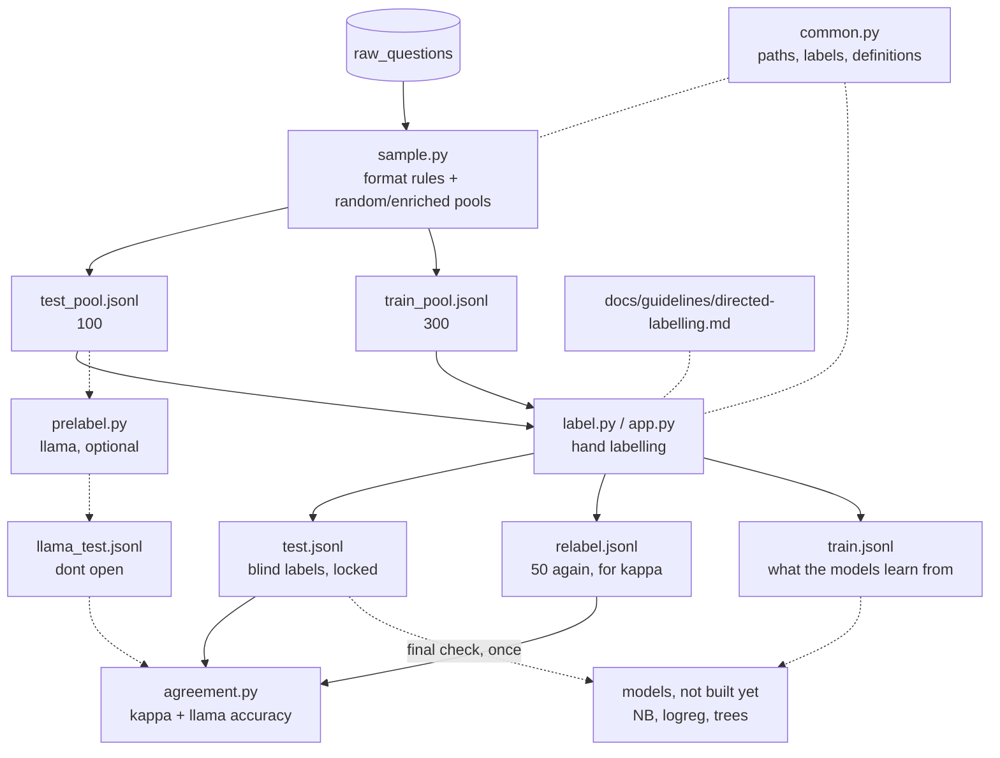

# directed-question labeling (ADR 012)

Labels each question `general` / `fixable` / `unsalvageable` (+ `unsure`).
Edge cases and how to decide: [docs/guidelines/directed-labelling.md](../../../docs/guidelines/directed-labelling.md). Read it before every labelling session.
The test: take out who it's addressed to. Can a typical partner still answer it from their own life?

This folder only builds and checks the labels. The models (naive bayes, L1 logreg, boosting) aren't here yet.

## map

Solid = done, dashed = later or optional.

## order matters

| # | command | what it does |
|---|---|---|
| 1 | `python3 -m src.ml.directed.sample` | pulls from `raw_questions`, keeps what passes the format rules, picks a random + enriched pool, splits into ~100 test / ~300 train. run once |
| 2 | `python3 -m src.ml.directed.label` | blind-label the 100 test questions in the terminal. no llama, no rules shown |
| 3 | `streamlit run src/ml/directed/app.py` → **train** mode | hand-label the 300 train questions, same guideline. writes `train.jsonl` |
| 4 | `python3 -m src.ml.directed.label --relabel` (or the app's relabel mode) | a week+ after step 2, label 50 test questions again without seeing ur first answer |
| 5 | `python3 -m src.ml.directed.agreement` | kappa, plus llama's blind test accuracy once prelabel has run |

**Llama (later, optional):** `prelabel.py` scores llama on the test set for the model comparison. Write and freeze the prompt on a few train questions first, and never put test questions in it (ADR 012). `import_labels.py` + `label_studio.xml` are from the old llama-assisted plan and arent needed now.

Ollama: `ollama serve` + `ollama pull llama3.1:8b`.

## files in data/directed

- `test_pool.jsonl` / `train_pool.jsonl`: the questions, split once by `sample.py`
- `test.jsonl`: ur blind labels. locked, final comparisons only
- `relabel.jsonl`: the 50 relabels, for kappa
- `train.jsonl`: ur hand labels for the train pool, from the app's train mode
- `llama_test.jsonl`: llama's test labels. **dont open this**, the anchoring check depends on u never seeing it
- `llama_train.jsonl`: llama's train labels, for counting overrides
